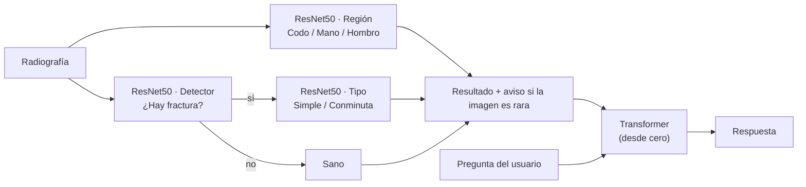
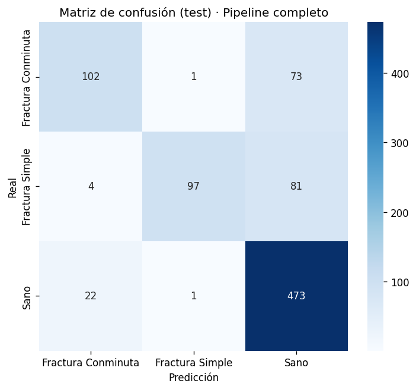
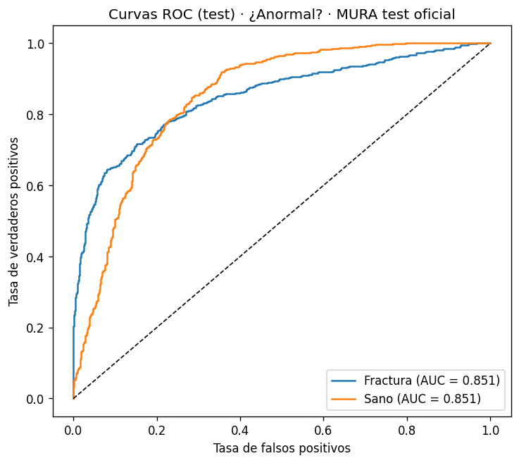

# BoneFracture AI

<!-- TODO: reemplazar <usuario> por el usuario de Hugging Face -->
**[Probar la demo](https://huggingface.co/spaces/<usuario>/BoneFractureAI)**

BoneFracture AI analiza radiografías de **codo, mano y hombro**. Indica qué región es, si hay una fractura y, cuando la hay, si es **simple o conminuta**. Después se le pueden hacer preguntas sobre el resultado a un pequeño **Transformer implementado desde cero en PyTorch**.

Es un proyecto universitario que recorre el ciclo completo de un modelo de visión: conseguir los datos, entrenar, medir con honestidad y llevarlo a una aplicación web.

> **Aviso:** es un proyecto académico y **no sirve para diagnosticar a nadie**. Ante cualquier lesión, lo que corresponde es ir al médico.

<!-- TODO: agregar captura o GIF de la app -->
<!--  -->

## Cómo funciona



El sistema combina tres redes ResNet50 (partiendo de los pesos de ImageNet) y un chatbot:

1. **Región anatómica**: reconoce si la imagen es de un codo, una mano o un hombro.
2. **Detector**: decide si hay fractura. El umbral no es el típico 0,5: se eligió con los datos de validación para equilibrar falsos positivos y falsos negativos.
3. **Tipo**: si hay fractura, la clasifica como simple o conminuta.
4. **Chatbot**: un Transformer decoder al estilo GPT (atención causal, 3 bloques, 4 cabezas), escrito sin librerías de modelos de lenguaje. Se entrenó con un corpus pequeño de preguntas habituales ("¿es grave?", "¿necesito cirugía?", "¿cuánto tarda en sanar?"), así que responde bien a ese tipo de preguntas y no a cualquier cosa. La idea es mostrar cómo funciona un Transformer por dentro, no competir con un modelo de lenguaje grande.

El backend está hecho con Flask y la interfaz con HTML y JavaScript, sin frameworks.

### Problemas que aparecieron por el camino

**El primer modelo hacía trampa.** La primera versión era una sola red con tres clases (sano, simple y conminuta) y llegaba a un 93 % de acierto. El número parecía muy bueno, hasta que se probó con radiografías de otro hospital: respondía lo mismo para casos sanos y con fractura. Como las imágenes sanas venían de un dataset y las fracturas de otro, el modelo había aprendido a **reconocer de qué dataset venía cada imagen**, no a ver la fractura.

La solución fue dividir el problema en dos etapas y entrenar cada una con clases que vienen de la misma fuente:
- el **detector** aprende de FracAtlas y MURA, que tienen casos sanos y con lesión de los mismos hospitales;
- el **clasificador de tipo** aprende de un dataset de Mendeley con fracturas simples y conminutas.

Además, todas las imágenes se pasan a escala de grises para que el color no le dé pistas al modelo, y se quitaron las radiografías con implantes metálicos para que no detecte una "fractura" solo por ver un tornillo.

**El detector no generalizaba.** Entrenado solo con FracAtlas funcionaba bien con imágenes de FracAtlas, pero con radiografías de MURA acertaba lo mismo que lanzar una moneda (AUC 0,49). Al sumar MURA al entrenamiento, con miles de pacientes distintos, el AUC subió a **0,85**.

### Aviso de imagen fuera de lo normal
Un modelo solo es fiable con imágenes parecidas a las que vio al entrenar. Por eso la app muestra un aviso de **"resultado poco fiable"** cuando:
- no está segura de que la imagen sea un codo, una mano o un hombro (por ejemplo, si se sube un fémur), o
- la imagen tiene color, lo que suele indicar una foto de una placa o de una pantalla en lugar de una radiografía digital.

## Resultados

Todo está medido con imágenes que los modelos **no vieron durante el entrenamiento**. En MURA los datos se separaron por paciente, para que una misma persona no aparezca a la vez en entrenamiento y en test. Los informes completos, con matrices de confusión y curvas ROC, están en [`reports/`](reports/).

| Modelo | Datos de test | Imágenes | Accuracy | AUC |
|---|---|---|---|---|
| Región anatómica | MURA | 1 482 | **99,2 %** | 1,00 |
| Detector de fractura | MURA (normal vs. anormal) | 1 482 | 77,5 % | **0,85** |
| Detector de fractura | FracAtlas | 589 | 87,6 % | 0,86 |
| Tipo (simple vs. conminuta) | Mendeley | 358 | **96,9 %** | 0,99 |
| **Sistema completo** (sano / simple / conminuta) | FracAtlas + Mendeley | 854 | **78,7 %** | – |

En MURA, el detector funciona mejor con el codo (AUC 0,91) que con la mano (0,82) o el hombro (0,83).

<p>
  
  
</p>

### Limitaciones
- **Se le escapan fracturas.** Cuando el detector encuentra la fractura, el tipo se acierta casi siempre (97 %). El problema está antes: el detector solo encuentra alrededor de la mitad de las fracturas del conjunto de test (57 % en Mendeley y 46 % en FracAtlas). Es la parte con más margen de mejora.
- En MURA, "anormal" no siempre significa fractura: también incluye artrosis, implantes y otras lesiones. Se usó como la mejor aproximación disponible.
- Solo conoce codo, mano y hombro. Con otros huesos, o con imágenes que tienen flechas, texto o recortes, el resultado no es fiable. La app avisa en la mayoría de esos casos, pero no en todos.

## Instalación

Requiere **Python 3.10–3.12**.

```bash
git clone https://github.com/<usuario>/BoneFractureAI.git
cd BoneFractureAI
python -m venv venv
venv\Scripts\activate        # Windows
# source venv/bin/activate   # Linux / macOS
pip install -r requirements.txt
```

Los pesos de los modelos ocupan unos 650 MB, por lo que no están en este repositorio sino en Hugging Face Hub <!-- TODO: enlace al repo de pesos -->. Si se define esta variable de entorno, la app los descarga sola la primera vez:

```bash
set HF_WEIGHTS_REPO=<usuario>/bonefracture-ai-weights      # Windows (cmd)
# export HF_WEIGHTS_REPO=<usuario>/bonefracture-ai-weights # Linux / macOS
```

También se pueden descargar a mano y dejarlos en `weights/`:

```
weights/
├── ResNet50_BodyParts.h5     # región anatómica
├── fracture_detector.h5      # ¿hay fractura?
├── fracture_type.h5          # simple o conminuta
├── fracture_config.json      # umbral del detector
└── MedicalGPT_Scratch.pth    # chatbot
```

Para arrancar la app:

```bash
python run.py
```

La app queda en http://localhost:5000. Basta con subir una radiografía y preguntar, por ejemplo, *"¿necesito cirugia?"*.

**Con Docker:**
```bash
docker build -t bonefracture-ai .
docker run -p 7860:7860 -e HF_WEIGHTS_REPO=<usuario>/bonefracture-ai-weights bonefracture-ai
```

**Tests:**
```bash
pip install -r requirements-dev.txt
pytest
```

Hay dos archivos de dependencias: `requirements.txt` tiene solo lo necesario para ejecutar la app, y `requirements-dev.txt` añade lo que hace falta para entrenar y correr los tests (scikit-learn, pandas, matplotlib, seaborn y pytest).

## Entrenamiento

| Modelo | Cómo | Dónde |
|---|---|---|
| Detector y tipo de fractura | [`notebooks/finetune_fracture_colab.ipynb`](notebooks/finetune_fracture_colab.ipynb): fine-tuning con aumentación de datos. Descarga FracAtlas y Mendeley automáticamente y lee MURA desde Google Drive | Google Colab con GPU (~1,5 h) |
| Región anatómica | `python -m scripts.train_body_parts` | CPU |
| Chatbot | `python -m scripts.train_chatbot` | CPU (un par de minutos) |

Los scripts locales necesitan `requirements-dev.txt`, se ejecutan desde la raíz del proyecto y esperan los datos en `data/`.

## Estructura

```
BoneFractureAI/
├── run.py              # Servidor Flask
├── app/
│   ├── controllers/    # Rutas de la API (/api/upload, /api/chat)
│   ├── models/         # Modelos de visión, Transformer y tokenizador
│   ├── utils/          # Preprocesamiento y descarga de pesos
│   └── views/          # Página web
├── notebooks/          # Entrenamiento en Google Colab
├── scripts/            # Entrenamiento local
├── reports/            # Métricas y gráficos
└── tests/              # Tests de la API
```

## Créditos

El proyecto se apoya en estos datasets públicos:

| Dataset | Uso | Licencia |
|---|---|---|
| [MURA](https://stanfordmlgroup.github.io/competitions/mura/), Stanford ML Group (Rajpurkar et al., 2017) | Región anatómica y detector | Solo investigación, no comercial |
| [FracAtlas](https://doi.org/10.6084/m9.figshare.22363012) (Abedeen et al., *Scientific Data*, 2023) | Detector | CC BY 4.0 |
| [X-ray Bone Fracture Dataset](https://doi.org/10.17632/8d9kn57pdj.1), Mendeley Data | Tipo de fractura | CC BY 4.0 |

La idea del clasificador de región anatómica viene de [Alkoby/Bone-Fracture-Detection](https://github.com/Alkoby/Bone-Fracture-Detection).

Por la licencia de MURA, los modelos de este proyecto son **solo para uso académico y no comercial**.

## Próximos pasos
- Conseguir que el detector encuentre más fracturas, entrenándolo con datos de más hospitales y más huesos.
- Mapas de calor (Grad-CAM) para ver en qué parte de la imagen se fija el modelo.
- Un modelo que reconozca cuándo una imagen no es una radiografía, en lugar de usar reglas fijas.
